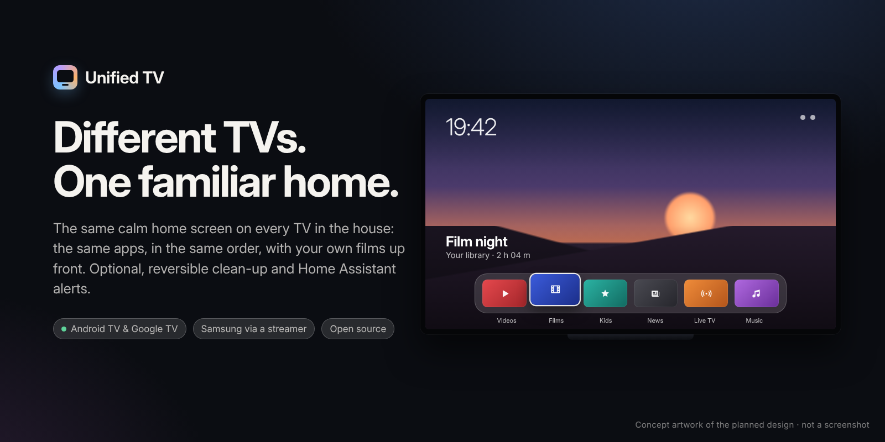
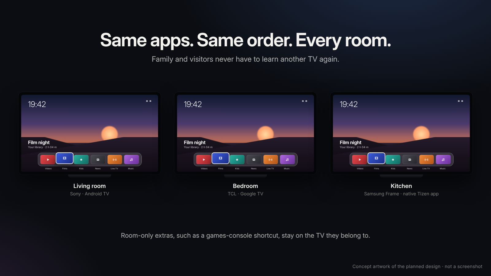
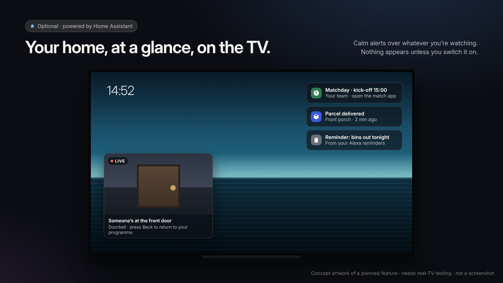
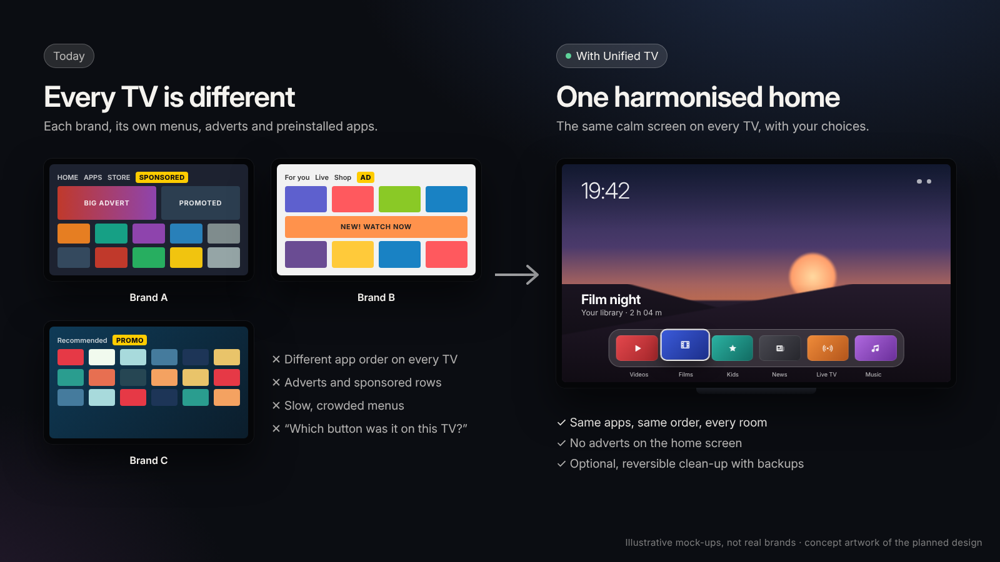

# Unified TV

### Different TVs. One familiar experience.

**One calm, advert-free home screen for every TV in the house.** A native Android TV app for Sony and TCL, a native Tizen app for Samsung Frame (in development), optional Home Assistant alerts and optional, reversible cleanup with backups.

 

Is every TV in your house different? A Sony in the lounge, a TCL in the bedroom, a Samsung in the kitchen: each with its own home screen, its own adverts and its own preinstalled apps, so the family and visitors never quite know where anything is. Even two Android TVs from different makers look and behave differently. Unified TV is an open-source launcher project that aims to put **the same apps, in the same order, with the same remote moves** on every screen, and to keep the films and programmes you love at the centre.

**Content first, underlying technology hidden.**

> **Latest: [Android Preview 0.4](https://github.com/tcrosswell-99/Unified-TV/releases/tag/android-preview-v0.4.0)**, a test prerelease of the separate `io.unifiedtv.preview` app: two-column Settings, automatic DLNA discovery with a direct-play trial, a five-image gallery, four VPN states and the official Amazon Music handoff. Its automated checks pass; it has **not** yet been installed on a TV, and editable Apps is still to come. [Built and remaining features](docs/FEATURE_STATUS.md) · [Specification v2.2](docs/PRODUCT_SPEC.md) · [AI handover](docs/AI_HANDOVER.md) · [Changelog](CHANGELOG.md)

> **Project status: early development.** This is a public fork of [CleanYourTV UI](https://github.com/matheus-caldeira/cleanyourtv-ui), preserving its existing Android TV code and history. The Unified TV features described below are a **design and development roadmap**, not an installable finished product. There is no verified Unified TV release yet. See [what works today](docs/STATUS.md).

## Why Unified TV?

- **One familiar home in every room.** The same dock, order and remote moves on every TV, so nobody has to relearn the television in another room. Each room can still have its own extras, such as a console shortcut only where the console is plugged in.
- **No adverts or endless rows.** One clean, editable dock of favourite apps that family members will be able to pin, remove or reorder with the remote. **Planned for Unified TV.**
- **Artwork that matches what you select.** Focus Netflix, BBC or a film in your own library, and the full-screen artwork changes to match that selection. Never an unrelated wallpaper behind a highlighted tile.
- **Your own films and series.** Browse a NAS collection through posters and a simple `View All` library, played inside Unified TV itself (Media3 on Android, AVPlay on Samsung). No separate player app and no VLC tile.
- **Your home at a glance, if you want it.** An optional Home view powered by open-source [Home Assistant](https://www.home-assistant.io): doorbell, reminders, deliveries, bin day and matchday, shown calmly over whatever you are watching. **Planned.**
- **A faster, calmer TV.** Optional, reversible cleanup with backups, explained one change at a time. Never a blanket debloat.
- **Less to learn.** Designed for children, grandparents, visitors and anyone who just wants to watch something.

The visual direction draws on the *principles* of contemporary tvOS motion and material design, alongside the clean, gallery-like restraint of [CleanFrame by Nathan Clark](https://github.com/nthnclrk/CleanFrame). It is an **original interface**, not an Apple product, replica or affiliated project.

## What works today, and what is planned

| Status | Meaning |
| --- | --- |
| ✅ **Available today (inherited, works now)** | Code inherited from CleanYourTV or CleanYourTV UI that you can build and use now, under its original instructions. Not yet the Unified TV design. |
| 🛠 **Planned** | Agreed design, not built yet. |
| 🔬 **Needs real-TV testing** | Depends on TV, platform or service behaviour that must be proven on real hardware before we claim it works. |

| Experience | Status | Notes |
| --- | --- | --- |
| Minimal, advert-free Android TV launcher (`launcher/`) | ✅ Available today (inherited, works now) | Original CleanYourTV launcher: small, offline, no network permission. [Guide](README.cleanyourtv.md) |
| Richer home screen with film and series browsing (`launcher-ui/`) | ✅ Available today (inherited, works now) | CleanYourTV UI, using TMDB. [Guide](docs/upstream/CLEANYOURTV_UI_README.md) |
| Per-model cleanup lists with recorded backups and restore (`tools/`, `examples/`) | ✅ Available today (inherited, works now) | Community lists for over 250 Android TV models. Use only with the [recovery-first process](docs/INSTALLATION_AND_RECOVERY.md). |
| Optional add-ons: Home Assistant panel, camera alerts, weather, sleep timer, quiet hours | ✅ Available today (inherited, works now) | Community apps in [`addons/`](addons/README.md). Recent fixes are code-checked only, not yet re-tested on TCL or Sony. |
| Unified TV Android Preview (`preview/`) | 🔬 Needs real-TV testing | [Preview 0.4](https://github.com/tcrosswell-99/Unified-TV/releases/tag/android-preview-v0.4.0) is a published test APK, separate from the TV's own Home. Automated checks pass; see [what is built and what is not](docs/FEATURE_STATUS.md). |
| Same apps, same order, on every TV in the house | 🛠 Planned | The preview has the curated dock with remote reorder; adding and removing apps through an Apps screen is not built yet. See [app customisation](docs/APP_CUSTOMISATION.md). |
| Premium glass dock with artwork matched to the selection | 🛠 Planned | [Design system](docs/DESIGN_SYSTEM.md). Lighter rendering on TCL and older Sony, same layout. |
| NAS film and series library | 🔬 Needs real-TV testing | The preview discovers DLNA servers and has a direct-play trial; the poster-first library and real NAS playback are still to come. |
| Home view: Home Assistant alerts and glances | 🛠 Planned | Opt-in, set up on the TV. [Design note](docs/HOME_VIEW.md). |
| Ring doorbell live view, on a press **or a person detected**, even from artwork mode | 🔬 Needs real-TV testing | A release gate for the reference household. Not proven on any TV, including native Samsung Art Mode. |
| Alexa reminder toasts over playback | 🔬 Needs real-TV testing | Depends on a reliable event source and on overlays being allowed above each app. |
| Live TV guarded by NordVPN | 🔬 Needs real-TV testing | Live TV opens only while NordVPN is connected, and is covered if NordVPN drops (OD-26). That isn't a kill switch, and a status icon alone is never one: only Android's always-on block stops traffic. |
| Music (Amazon Music) and an optional voice assistant | 🔬 Needs real-TV testing | Research only. Neither works today. |
| Samsung Frame native app (Tizen) | 🛠 Planned | A separate native Tizen app with the same design, alongside Samsung's own Home, Art Mode and TV Plus. Not built or installed yet. |
| Optional TV Performance & Cleanup journey with consent at every step | 🛠 Planned | Builds on the inherited tools; scan, explain, back up, apply, verify rollback. |

**Nothing marked 🛠 or 🔬 is implemented yet.** More ideas, clearly labelled as ideas, are in the [feature ideas catalogue](docs/IDEAS.md). Changes are recorded in the [changelog](CHANGELOG.md).

## Home view: your home at a glance

[Home Assistant](https://www.home-assistant.io) is free, open-source home automation that many households already run. The planned Home view uses it so the TV can show what matters without buying a separate home hub or display: someone at the door, an Alexa reminder, a parcel delivered, bin day, kick-off time for your team. One alert at a time, the most important first, then it gets out of the way.

Everything is **optional and opt-in**, configured per household on the TV itself. Home Assistant addresses and tokens are entered on the TV, never written into this repository. When nothing is connected, nothing appears. Read the [Home view design note](docs/HOME_VIEW.md) for the alert order and what still needs real-TV tests.

## One design, different hardware

- **Android first: Sony and TCL.** A native Android TV app. TCL and older Sony hardware get the same design with lighter rendering where necessary.
- **Samsung next.** On Samsung (Tizen), an Android APK **cannot** run and the inherited tools cannot connect (see the [Samsung Tizen notes](docs/devices/samsung-tizen.md)). The plan is a separate native Tizen Web Application for the Frame, with the same look and remote moves, while Samsung's Smart Hub stays the system Home and native Art Mode and Samsung TV Plus are kept. No external streaming box is required. The Tizen app is unfinished and nothing has been installed on a Frame yet.
- **Other TVs later.** Possible only through supported platform adapters or suitable external devices. No claim of universal installation or bloatware removal.

A Ring doorbell **must** interrupt wallpaper/art mode on the reference deployment and show live video automatically. This is a release gate, **not** a claim that Samsung already permits third-party overlays. An alternative source/input transition needs to be proven on hardware. See [compatibility](docs/COMPATIBILITY.md).

## The TV your family knows

The reference household uses six familiar choices: **SmartTube · Netflix · Disney+ · BBC · Live TV · Music**. A console tile appears only on the TV the console is connected to; Samsung TV Plus only where it is installed. Pressing **Down** reveals your own films and series, instead of leaving posters permanently covering the home screen.

All these are *configurable examples*, not compulsory apps. The planned **Apps** screen lets viewers pin and rearrange dock shortcuts independently for each TV; it never uninstalls an app. See [app customisation](docs/APP_CUSTOMISATION.md). People without a NAS, Ring, Alexa, a console, a VPN or an AI subscription should still have a lovely, responsive launcher.

## Faster, calmer TV: optional and reversible

Our intent is no advertising, no sale of household data and no mandatory analytics. Personal photos, media paths, Home Assistant URLs and API credentials stay out of Git and public issue reports. Integrations are opt-in and should fail quietly when disconnected.

The optional **TV Performance & Cleanup** journey is separate from installation. On supported Android models, it must inspect the device, explain every proposed change, save original package states and offer independent rollback. **Never automatically debloat a user's television.** Samsung Tizen has different limits; native Samsung package removal is not promised.

## Try it safely today

This is a **development fork**, not a finished installer.

**The Unified TV Android Preview** is an isolated test app (`io.unifiedtv.preview`) that never replaces the TV's own Home. Download it from the [Preview 0.4 release](https://github.com/tcrosswell-99/Unified-TV/releases/tag/android-preview-v0.4.0) and read [what it can and cannot do](docs/FEATURE_STATUS.md) and the [preview notes](docs/FIRST_ANDROID_PREVIEW.md) first. It is not yet a household release or a working Ring, NAS or VPN integration.

**The inherited CleanYourTV code** can be used under its original instructions:

1. **Read the recovery notes first:** [installation and recovery](docs/INSTALLATION_AND_RECOVERY.md). Test on an emulator or a spare device before a family TV.
2. **The original CleanYourTV guide:** [README.cleanyourtv.md](README.cleanyourtv.md) covers the minimal launcher, the per-model lists and how the tools record each package's original state so `tools/restore.sh` can put it back.
3. **The CleanYourTV UI guide:** [docs/upstream/CLEANYOURTV_UI_README.md](docs/upstream/CLEANYOURTV_UI_README.md) covers the richer home screen.

Those instructions and scripts are inherited from their authors and do not install the future Unified TV experience. Please **do not apply package changes or use ADB on a household TV without model/firmware-specific research and a verified restore path**.

**Translations of the original guides:** the CleanYourTV guide in [日本語](README.ja.md), [Tiếng Việt](README.vi.md) and [简体中文](README.zh-CN.md); the CleanYourTV UI guide in [Português](README.pt-BR.md). They describe the inherited projects, not Unified TV.

## Read more

[Product specification](docs/PRODUCT_SPEC.md) · [Feature status](docs/FEATURE_STATUS.md) · [Design system](docs/DESIGN_SYSTEM.md) · [Home view](docs/HOME_VIEW.md) · [Feature ideas](docs/IDEAS.md) · [Compatibility](docs/COMPATIBILITY.md) · [All-TV test plan](docs/ALL_TV_TEST_PLAN.md) · [Household adapters](docs/HOUSEHOLD_ADAPTERS.md) · [Status](docs/STATUS.md) · [Roadmap](docs/ROADMAP.md) · [AI handover](docs/AI_HANDOVER.md) · [Changelog](CHANGELOG.md)

## Project and community

Unified TV is being built for a real family first, with the source openly available for anyone who wants to experiment, adapt it to their home or help improve it. Contributions, suggestions and real device test reports are welcome through [GitHub Issues](https://github.com/tcrosswell-99/Unified-TV/issues) and [Discussions](https://github.com/tcrosswell-99/Unified-TV/discussions).

See [Contributing](CONTRIBUTING.md), [Security](SECURITY.md) and [Credits](CREDITS.md). Coding agents should follow [AGENTS.md](AGENTS.md). No supported Unified TV release or supported-devices list has been published yet; Android Preview 0.4 is a test prerelease.

## Credit and licence

This repository is a **GitHub fork** of [CleanYourTV UI by Matheus Caldeira](https://github.com/matheus-caldeira/cleanyourtv-ui), built on [CleanYourTV by Gathin](https://github.com/Gathin23/cleanyourtv). The inherited UI also includes code from [Free My TV](https://github.com/simbasjungles/free-my-tv). The original history and licence files remain in the repository, including [MIT licence](LICENSE), [Free My TV licence](launcher-ui/LICENSE.free-my-tv) and [launcher attribution notice](launcher-ui/NOTICE). Please check the path for the Free My TV licence in the underlying source tree when preparing any redistribution.

[TV Detox](https://github.com/Ansub/tv-detox) by Ansub Khan and [CleanFrame](https://github.com/nthnclrk/CleanFrame) by Nathan Clark are credited research and design references. **No code or visual assets from these projects have been imported into Unified TV** at this stage. Any future code integration will preserve the applicable original copyright and licence notices. Details: [CREDITS.md](CREDITS.md).

Unified TV is independent of Apple, Samsung, Sony, TCL, Google, Amazon, NordVPN and the streaming services it launches. Their names and trademarks belong to their owners.

**Different TVs. One familiar experience.**
