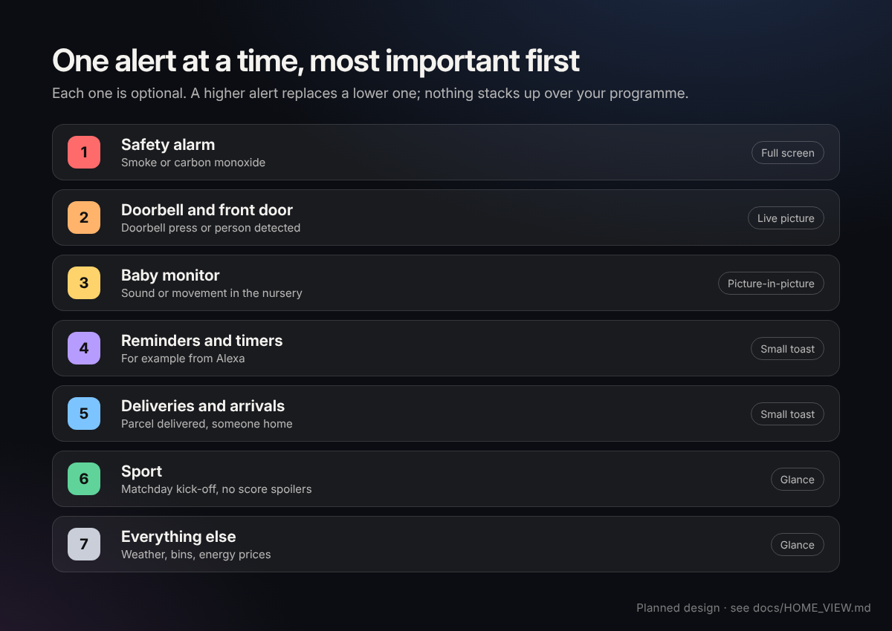

# Home view: design note

> **Status: planned design, not a working feature.** Nothing on this page has been built as a Unified TV feature or tested on a real television. It refines the household requirements in the [Product Spec v2.2](PRODUCT_SPEC.md) (sections 4.10, 8 and 16.2) and the [Design system](DESIGN_SYSTEM.md); where they disagree, the Product Spec wins until it is updated. What the Android Preview has actually built is tracked in [FEATURE_STATUS.md](FEATURE_STATUS.md).

The Home view lets the TV show what is happening at home, using a household's own [Home Assistant](https://www.home-assistant.io) server. Home Assistant is free, open-source and runs locally, so a family that already has it, or sets it up on a small computer, gets doorbell, reminder and delivery alerts on the TV without buying a separate hub or smart display.

**North star: Content first, underlying technology hidden.** The programme stays the star. The viewer sees "Someone's at the front door", never "Home Assistant", an entity ID or an error code.

## Goals

- **Calm.** One alert at a time, small unless it matters, gone when it no longer matters. No sounds, flashing or stacked cards unless the household chooses them.
- **Useful at a glance.** Short words a guest or grandparent understands. Every alert has an obvious way back (Back) and never steals focus from playback.
- **Optional, opt-in, per household and per TV.** The launcher works fully without Home Assistant. Each alert type has its own switch, and each TV can opt in separately (for example, no alerts in a child's room).
- **Nothing personal in public source.** No addresses, tokens, camera URLs, names, photos or preferences in this repository ([AGENTS.md](../AGENTS.md) rule 6).

## What it can show

| Mode | What it looks like | Used for |
| --- | --- | --- |
| **Glance strip** | A small card or two in a corner of Home, or a short toast over playback, that leaves by itself | Reminders, deliveries, arrivals, sport, bins, weather |
| **Picture-in-picture** | A live camera window in a safe corner; the programme keeps playing | Doorbell (default) |
| **Full takeover** | The whole screen, until dismissed or the event ends | Doorbell over artwork or wallpaper, or where the TV blocks a floating window |

## Alert priority

One alert is on screen at a time. A higher alert replaces a lower one; the lower one is queued briefly and dropped once it is stale. Nothing stacks over the programme.

| Priority | Alert | Default presentation | Typical source |
| --- | --- | --- | --- |
| 0 | **Smoke or carbon monoxide alarm** | Full-screen takeover with plain instructions; other sound paused; a doorbell press becomes one line on it | Home Assistant smoke and carbon monoxide sensors (their own device class) |
| 1 | **Doorbell:** a Ring press or a person detected | Live picture-in-picture; full takeover over artwork or wallpaper | Ring integration, camera alerts |
| 2 | **Reminders**, for example from Alexa | Small toast at a safe corner | Alexa reminder entities |
| 3 | **Deliveries and arrivals:** parcel delivered, someone home | Small toast | Doorbell/camera events, presence sensors |
| 4 | **Sport:** matchday kick-off, no score spoilers | Glance | A calendar or fixtures sensor |
| 5 | **Everything else:** weather, bin day, energy prices | Glance | Weather, calendar and energy sensors |

Priorities 1 and 2 are the Product Spec's own order: **Ring is priority 1 among everyday alerts, then Alexa reminders**; only a smoke or carbon monoxide alarm ranks above Ring (spec section 4.10; [AGENTS.md](../AGENTS.md) rule 7). An Alexa reminder that arrives during a Ring alert is queued briefly, then dropped once stale. Priorities 3 to 5 are proposed glances from the [ideas catalogue](IDEAS.md). VPN prompts (priority 3 in the spec, only when Live TV is activated) and voice (priority 4) are not Home view alerts and keep the spec's order.

**Owner decision OD-07, 25 October 2026: smoke and carbon monoxide come first.** A smoke or carbon monoxide alarm ranks above the doorbell (priority 0). Among everyday alerts, the spec's order is unchanged: Ring first, then reminders. The alarm screen adds to the home's alarms and never replaces them; it only reaches a TV that is on with household alerts running. Not yet tested on a TV.

**Proposal awaiting an owner decision:** a **baby monitor** picture-in-picture. Until then it is not part of the design.

Further rules:

- **Samsung native Art Mode** stays pristine: no glance strip or reminder toasts there by default. Whether a doorbell can interrupt native Art Mode is an open hardware question, not a promise.
- **TV off is not ambient mode.** Alerts never wake a TV that is fully off unless the household explicitly configures it.
- **Quiet times.** Glance-level alerts (4 and 5) respect a household's quiet hours and can be muted for a film night. The doorbell is never muted by quiet hours without a separate, explicit choice.
- **Privacy option.** A reminder can show only "Reminder" instead of its personal text, for TVs that guests use.

## How a household connects it

1. In Home Assistant, the owner creates a **long-lived access token** (Profile → Security → Long-lived access tokens), ideally for a dedicated user with only the access the TV needs.
2. On the TV, **Settings → Connections** finds Home Assistant on the home network and pre-fills its address, or the owner types it. The token is entered with the remote or a phone remote keyboard. **Test**, **Save** and **Forget** work from the remote ([Product Spec](PRODUCT_SPEC.md) section 2.1). Android Preview 0.4 has this screen and the discovery step; real authentication on a TV is still to be tested.
3. Credentials are stored only on the TV, in the preview's encrypted local store, which is excluded from backups. They are never committed to Git, put in an APK, an issue, a log or a screenshot, and the preview does not accept configuration from other apps or over ADB.

Home Assistant should stay on the home network. Do not expose it to the internet for the TV's sake.

## Which Home Assistant integrations make which feature possible

| Feature | Home Assistant building block | Notes |
| --- | --- | --- |
| Doorbell press, person detected, live view | [Ring integration](https://www.home-assistant.io/integrations/ring/) (or ring-mqtt), or a local NVR such as Frigate | Ring live video still depends on Ring's cloud service |
| Alexa reminders and timers | Official [Alexa Devices](https://www.home-assistant.io/integrations/alexa_devices/) integration, or the community Alexa Media Player integration | The official integration polls about every five minutes; a reminder may arrive late, so timing must be measured |
| Doors, windows, garage, locks (ideas) | Sensor and lock entities from the household's own devices | A TV remote never unlocks a door |
| Deliveries, arrivals | Camera/doorbell events, presence or device-tracker entities | |
| Matchday, bin day | A calendar or fixtures sensor | Fixtures must handle postponements; no score spoilers |
| Weather, energy prices | Weather and energy sensors | |
| Text toasts over any app on Android TV | [Notifications for Android TV / Fire TV](https://www.home-assistant.io/integrations/nfandroidtv/) or our own receiver | Needs "Display over other apps"; protected video and HDMI inputs may block overlays |

## Building blocks already in this repository

The Android Preview already has experimental pieces, described in [FEATURE_STATUS.md](FEATURE_STATUS.md): an authenticated Home Assistant WebSocket adapter for Ring door and person events and reminders, alert priority and de-duplication, and a camera overlay. None has been tested with a real camera or reminder source.

These inherited community pieces are useful references, not the Home view itself:

- [`addons/smart-home`](../addons/smart-home/README.md): a Home Assistant panel on the TV that reads `GET /api/states` while it is open, with the on-TV address and token setup described above. Locks are shown, never operated.
- [`addons/frigate-glance`](../addons/frigate-glance/README.md): camera alert cards over whatever is playing, with dismiss, snooze and full-screen actions. The closest existing pattern for doorbell alerts.
- The launcher's race-weekend mode, fed by [`tools/race_calendar.py`](../tools/race_calendar.py): an example of a glance that appears only when relevant.
- [`addons/weather`](../addons/weather/README.md), [`addons/sleep-timer`](../addons/sleep-timer/README.md) and [`addons/quiet-hours`](../addons/quiet-hours/README.md): weather, a countdown over playback, and a night-time volume cap.

## Privacy and failure behaviour

- **Fail quietly.** If Home Assistant is unreachable, the token is wrong or the TV is offline, nothing appears on the viewing screen. The state is visible only in Settings → Connections.
- **Never fake it.** No stale or invented alerts, and never label a still picture "Live". A truthful "Connecting" state is allowed before camera frames arrive.
- **Minimal data.** Read only the entities the household selects. Keep alert text briefly in memory; do not log it or send it anywhere else.
- **Home first.** Returning Home and launching apps must stay fast while Home Assistant is slow or down.

## What needs real-TV tests

Before any of this is described as working, record the model, firmware, build and result in [Compatibility](COMPATIBILITY.md):

- Doorbell press and person detection opening live video automatically over Home, playback and artwork, and returning to exactly where the viewer was, on Sony, TCL and the native Samsung Frame app.
- **Native Samsung Art Mode:** whether a doorbell can interrupt it at all ([AGENTS.md](../AGENTS.md) rule 1). Not claimed.
- Overlays above Netflix, BBC iPlayer, SmartTube, Live TV and HDMI inputs, including protected video.
- Alexa reminder delay against the real due time, edits and cancellations, and a reminder colliding with a doorbell event (rule 7).
- Live TV launched from an alert or glance still goes through the verified NordVPN check (rule 8).
- Behaviour after a reboot, after standby, and with Home Assistant offline.
